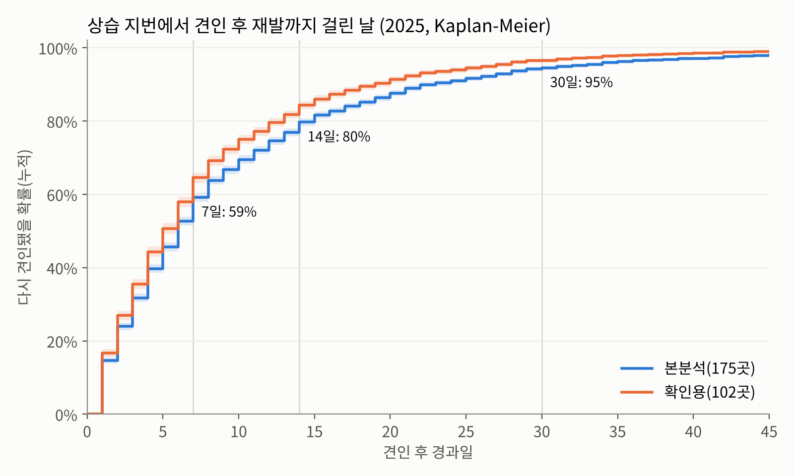
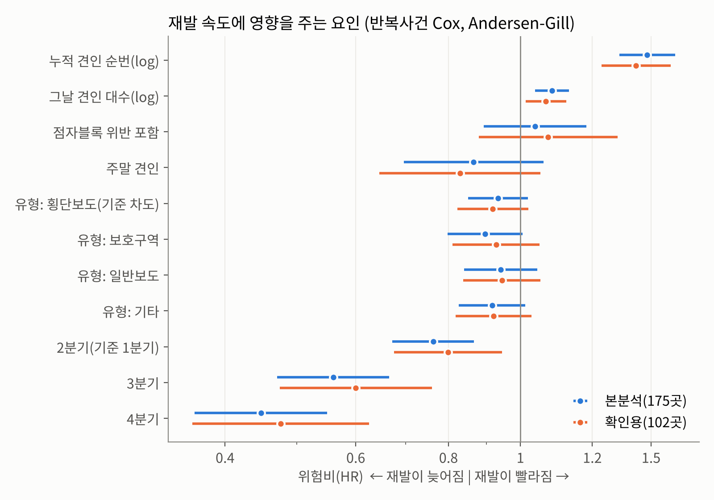

# 상습 지번 전동킥보드 견인 재발 주기 분석

> 서울시 PM(전동킥보드) 견인 데이터 2025 · 상습 견인 지번 175곳 · 재발 간격 6,288개

## 요약

**상습 지번에서는 견인하고 평균 6일 안에 다시 견인된다.** 10곳 중 8곳은 2주 안에 같은 자리로 돌아온다. 견인을 반복해도 재발 간격이 길어지지 않는다. 견인은 킥보드를 치울 뿐 다시 세워지는 것을 막지 못한다.

---

## 1. 분석 목적

점자블록 위 킥보드를 막는 지금의 주된 수단은 신고 → 견인이다. 견인이 재발을 막고 있다면 견인을 늘리면 된다. 막지 못하고 있다면 주차구역 신설, 반납금지구역, 과태료처럼 다른 수단이 필요하다.

그래서 이렇게 물었다. **"한 번 견인된 자리는 얼마 만에 다시 견인되는가? 견인이 쌓이면 그 간격이 길어지는가?"**

## 2. 분석 데이터

| 항목 | 내용 |
|---|---|
| 원자료 | 서울시 전동킥보드 견인 현황 2025.1~12 (2개 파일, 월별 시트) |
| 파일 | `data/raw/서울특별시_전동킥보드_견인_현황(25.1~6월).xlsx`, `data/raw/서울특별시_전동킥보드_견인_현황(25.7~12월).xlsx` |
| 전체 건수 | 2025년 64,734건 (오신고 22건 포함) |
| 분석 연도 | **2025년** (오신고 22건 제외) |
| 사용 컬럼 | 신고일, 주소(지번), 유형(위반 구분), 조치일 |

- 2025년은 신고일과 조치일이 99% 이상 같은 날이다. 그래서 **신고일을 견인일로 본다.**
- 2024년 자료에는 광진구·성동구·동대문구 등 2025년에 기록이 거의 없는 구가 섞여 있다. 연도 비교가 왜곡되지 않도록 분석은 2025년 한 해로 한정했고, 코드도 2025년 원자료 2개만 읽는다.

## 3. 상습 지번 선정

### 3-1. 집계 원리: 견인일수 기준

하루에 킥보드 10대를 한꺼번에 견인하면 데이터에는 10줄이 남는다. 건수로 세면 이런 일괄 견인 하루가 "10번 재발한 곳"처럼 보인다. 실제로 같은 지번·같은 날 기록이 전체의 22%다. 그래서 **견인이 있었던 서로 다른 날짜 수(견인일수)** 로 센다.

### 3-2. 선정 기준

| 기준 | 의미 | 이유 |
|---|---|---|
| 견인일수 **24일 이상** | 2025년 견인 지번 17,983곳 중 **상위 1%** | 24일 = 한 달에 두 번꼴 |
| 견인월수 **9개월 이상** | 12개월 중 9개월 이상 견인 | 특정 시기에만 몰린 곳 제외 |

- **본분석: 175곳** (2025년 견인 건수의 18.0%)
- **확인용: 102곳** (견인일수 30일 이상 + 10개월 이상, 더 엄격한 기준). 기준을 바꿔도 결론이 같은지 보는 민감도 분석에 쓴다.
- 구별로는 마포구 29곳, 서초구 20곳, 강남·양천·관악구 각 19곳 순이다. 1위는 **마포구 서교동 415** (견인일수 120일, 12개월 모두 견인)다.

## 4. 분석 방법 및 원리

### 4-1. 재발 간격 산출

지번마다 견인일을 시간순으로 줄 세우고, **이번 견인일에서 다음 견인일까지의 날 수**를 잰다.

```
서교동 415 (실제 기록)
1/10 ──3일── 1/13 ──4일── 1/17 ──17일── 2/3 ... 12/22 ──2일── 12/24 ──(7일, 연말까지 재견인 없음)── 12/31
         재발          재발           재발              재발                 중도절단
```

마지막 견인 뒤 연말까지 다시 견인되지 않은 구간은 "재발하지 않았다"가 아니라 **"관측이 끝나서 모른다"** 이다. 이런 구간을 **중도절단**이라고 부르고, 버리지 않고 "최소 이만큼은 버텼다"는 정보로 쓴다. 이 처리가 생존분석의 핵심이다.

### 4-2. Kaplan-Meier 생존곡선

**개념:** 마라톤에서 구간마다 몇 명이 남았는지 세는 것과 같다.

- 출발선에 재발 간격 6,452개가 서 있다.
- 1일째에 그중 몇 개가 다시 견인됐는지(탈락) 보고, "1일째를 버틴 비율"을 구한다.
- 2일째에는 1일째를 버틴 것들 중에서 다시 탈락 비율을 구한다.
- 이 비율을 계속 곱해 나간다.

$$
S(t) = \prod_{i \le t} \left(1 - \frac{d_i}{n_i}\right)
$$

| 기호 | 뜻 |
|---|---|
| $S(t)$ | 견인 후 $t$일이 지나도록 **아직 다시 견인되지 않았을 확률** |
| $d_i$ | $i$일째에 다시 견인된 간격 수 (탈락자) |
| $n_i$ | $i$일째 직전까지 남아 있던 간격 수 (생존자). 중도절단된 간격은 관측이 끝난 날 이후 여기서 빠진다 |

그림에서는 보기 쉽게 $1 - S(t)$, 즉 **"t일 안에 다시 견인됐을 확률"** 을 그렸다. 곡선이 빨리 올라갈수록 재발이 빠르다는 뜻이다. **중앙값**은 곡선이 50%를 넘는 날로, "절반이 다시 견인되기까지 걸린 날"이다.

### 4-3. 반복사건 Cox 모형

**개념:** Kaplan-Meier가 "평균적으로 며칠"을 보여준다면, Cox 모형은 **"어떤 조건일 때 더 빨리 돌아오나"** 를 비교한다.

$$
h(t \mid x) = h_0(t) \cdot e^{\beta x}, \qquad \text{위험비(HR)} = e^{\beta}
$$

| 기호 | 뜻 |
|---|---|
| $h(t \mid x)$ | 조건 $x$인 자리가 $t$일째에 **다시 견인될 순간 위험도** |
| $h_0(t)$ | 기준이 되는 자리의 위험도. 모양은 정하지 않고 데이터에 맡긴다 |
| $e^{\beta}$ (HR) | 조건이 하나 달라질 때 위험도가 **몇 배**가 되는지 |

**위험비(HR) 해석 기준**

- **HR = 1**: 차이 없음
- **HR > 1**: 재발이 **빨라짐** (예: 1.5 → 매 순간 다시 견인될 위험이 1.5배)
- **HR < 1**: 재발이 **늦어짐** (예: 0.5 → 위험이 절반)
- 95% 신뢰구간이 1을 포함하면 "차이가 있다고 말하기 어렵다"

**반복사건 보정 방법**

한 지번에서 재발이 수십 번 나오므로 같은 지번의 기록끼리는 서로 닮는다. 이를 무시하면 같은 사람에게 설문을 40번 받고 응답자가 40명이라고 세는 것과 같아진다. 그래서 두 가지 장치를 썼다.

1. **지번별 군집 보정(robust 표준오차)**: 같은 지번 기록은 한 묶음으로 보고 오차를 넓게 잡는다. 신뢰구간이 과장되게 좁아지지 않는다.
2. **두 모형으로 교차 확인**
   - **Andersen-Gill**: 모든 재발을 같은 출발선에 세우고, "몇 번째 견인인가(누적 순번)"를 변수로 넣는다. → *견인이 쌓이면 재발이 늦어지는가?* 를 직접 본다.
   - **PWP-GT**: 1번째 재발, 2번째 재발, …마다 출발선을 따로 둔다(순번 층화). → 순번에 따른 차이를 통제한 뒤 다른 요인을 본다.

**투입 변수**

| 변수 | 의미 |
|---|---|
| 누적 견인 순번(log) | 그 지번에서 올해 몇 번째 견인인가 |
| 그날 견인 대수(log) | 그날 그 지번에서 몇 대를 견인했나 |
| 점자블록 위반 포함 | 그날 견인 중 점자블록 위반이 있었나 |
| 위반 유형 | 차도(기준) / 횡단보도 / 보호구역 / 일반보도 / 기타 |
| 주말, 분기 | 견인한 날의 요일·시기 |

## 5. 분석 결과

### 5-1. 재발 간격 분포



| | 본분석(175곳) | 확인용(102곳) |
|---|---|---|
| 재발 간격 수 / 중도절단 | 6,288 / 164 | 4,405 / 93 |
| **재발 간격 중앙값** | **6일** (95% CI 6–6) | 5일 (95% CI 5–6) |
| 3일 안에 재발 | 32% | 35% |
| 7일 안에 재발 | 59% | 65% |
| **14일 안에 재발** | **80%** | 84% |
| 30일 안에 재발 | 95% | 97% |

→ 상습 지번은 견인하고 **일주일 안에 절반 이상, 2주 안에 80%** 가 다시 견인된다. 더 엄격한 기준(102곳)에서는 재발이 조금 더 빠르다. 견인이 더 잦은 곳만 골랐으니 예상한 방향이다.

### 5-2. 재발 속도 영향 요인



| 요인 | HR (본분석, Andersen-Gill) | 95% CI | 해석 |
|---|---|---|---|
| **누적 견인 순번(log)** | **1.48** | 1.36–1.62 | 견인이 쌓여도 간격이 **길어지지 않음** (오히려 짧아지는 방향) |
| **그날 견인 대수(log)** | **1.10** | 1.05–1.16 | 많이 치운 날일수록 **더 빨리** 다시 쌓임 |
| 점자블록 위반 포함 | 1.05 | 0.89–1.23 | 차이 없음 |
| 위반 유형 (차도 대비) | 0.90–0.94 | 모두 1 포함 | 차이 없음 |
| 주말 견인 | 0.87 | 0.70–1.07 | 차이 없음 |
| 3분기 / 4분기 (1분기 대비) | 0.56 / 0.45 | 1 미포함 | 하반기에 간격이 길어짐 (아래 주의 참고) |

PWP-GT 모형과 확인용 102곳에서도 **방향과 유의성이 모두 같다.** 견인 대수 HR은 1.08~1.13, 점자블록·유형·주말은 모두 유의하지 않았고, 분기 효과도 같은 방향이었다.

**결과 해석**

1. **견인은 억지 효과를 만들지 못한다.** 견인이 학습 효과를 준다면 순번이 쌓일수록 HR이 1보다 작아져야 한다. 결과는 1.48이다. 같은 자리를 계속 치워도 재발은 늦춰지지 않는다.
2. **많이 치울수록 빨리 다시 쌓인다.** 한 번에 많이 견인되는 곳은 그만큼 수요가 몰리는 곳이다. 치우는 것보다 **세울 자리를 만드는 것(주차구역 신설)** 이 필요하다는 근거가 된다.
3. **점자블록 위반이라고 견인 효과가 더 있지는 않다.** 점자블록 위에 세워진 날도 다른 위반과 똑같은 속도로 재발한다.

## 6. 단속 주기 영향 점검

데이터는 킥보드가 다시 세워진 순간이 아니라 **누군가 신고하고 견인이 처리된 날**만 기록한다. 그래서

$$
\text{관측 간격} = \text{재주차까지 시간} + \text{신고까지 시간} + \text{견인 운영일까지 대기}
$$

가 된다. 단속 쪽 패턴을 데이터로 확인했다.

| 지표 | 값 | 의미 |
|---|---|---|
| 평일 견인 비중 | **97.8%** | 견인은 사실상 평일에만 이뤄짐 |
| 영업일 기준 간격 중앙값 | **4영업일** | 주말을 빼면 더 짧음 |
| 다음 날 재발 비중 | 15.0% | 하루 만에 다시 세워지는 곳이 많음 |
| 3일 간격 중 금→월 | 47.6% | 주말 공백이 간격을 늘림 |
| 지번별 최다 요일 비중 | 28% (요일 무관 시 20%) | **정해진 순찰 요일은 없음**. 신고가 들어오면 견인하는 방식으로 보임 |
| 7일·14일 간격 몰림 | 7일 몰림 없음, 14일 약간 | 고정 주기 순찰 흔적 약함 |
| 구별 견인 운영일 | 강남 299일 … **마포 199일** | 마포는 견인이 없는 평일이 상대적으로 많음 |

→ 관측 간격은 실제 재주차 시간보다 **길거나 같다.** 따라서 이 분석의 재발 속도는 **보수적인 추정**이다. 실제 재발은 이보다 빠르면 빨랐지 느리지 않다. 결론("견인만으로는 막지 못한다")은 오히려 강해진다.

## 7. 한계 및 유의사항

- **선정 편향**: 견인이 잦은 지번만 골랐으므로 재발이 짧게 나오는 것은 어느 정도 당연하다. 결과는 "서울 전체 평균"이 아니라 **"상습 지번에서는"** 으로 읽어야 한다.
- **누적 순번 HR 1.48**에는 원래 견인이 잦은 지번이 순번도 높아지는 효과(지번 간 차이)가 섞여 있다. 그래서 "견인이 쌓이면 재발이 빨라진다"보다 **"견인이 쌓여도 재발이 늦어지지 않는다"** 로 쓰는 것이 정확하다.
- **분기 효과**: 2025년 10~12월은 서울 전체 견인 건수가 줄어든 시기다. 하반기의 긴 간격은 계절보다 **단속 강도 변화**일 수 있으므로 계절 효과로 단정하지 않는다.
- **모형 설명력**: 일치도(C-index) 0.55~0.58로 개별 재발 시점을 맞히는 힘은 약하다. 이 모형은 예측이 아니라 **요인의 방향과 크기를 비교**하는 데 쓴다.
- 신고 기반 자료라서 신고되지 않은 방치는 보이지 않는다.

## 8. 정책 제안 연계

| 분석 결과 | 이어지는 제안 |
|---|---|
| 견인 후 6일, 2주 안에 80% 재발 | 견인 중심 대응의 한계 → 사전 차단 수단 필요 |
| 많이 치울수록 빨리 다시 쌓임 | **② 신설 주차구역 입지 최적화** (와우산로 90-1 중심) |
| 견인이 쌓여도 억지 효과 없음 | **③ 과태료·신고포상 기대처벌 모형** (적발확률 × 과태료) |
| 다음 날 재발 15%, 반납 직후 문제 | **④ 앱 반납금지구역 지오펜싱** |
| 상습 지번의 마포구 집중 (29곳) | **⑤ 시범구역 선정** |

## 9. 재현 방법

```bash
# 저장소 최상위에서
pip install -r requirements.txt
cd 01_recurrence/src
python 01_load_data.py          # 2025년 견인 원자료 2개가 제대로 읽히는지 확인 (건수 출력)
python 02_select_lots.py        # 상습 지번 175곳 / 102곳 선정
python 03_survival_analysis.py  # Kaplan-Meier + 반복사건 Cox
python 04_figures.py            # 그림 2장
python 05_enforcement_pattern.py  # 단속 주기 점검
```

- 입력: `data/raw/`의 2025년 견인 원자료 2개 (받은 파일명 그대로). 목록은 `src/config.py`의 `RAW_TOW_2025`, 읽기·정제는 `config.load_tow_2025()` 한 곳에서 하고 02·03·05 단계가 이 함수로 원자료를 직접 읽는다.
- 중간 산출물: `data/processed/` (상습 지번 목록, 재발 간격 데이터)
- 결과: `01_recurrence/results/survival_results.xlsx`, `enforcement_pattern.xlsx`, `figures/`
