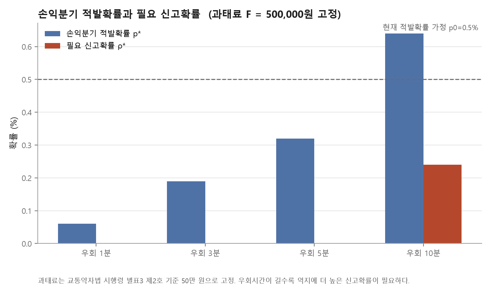
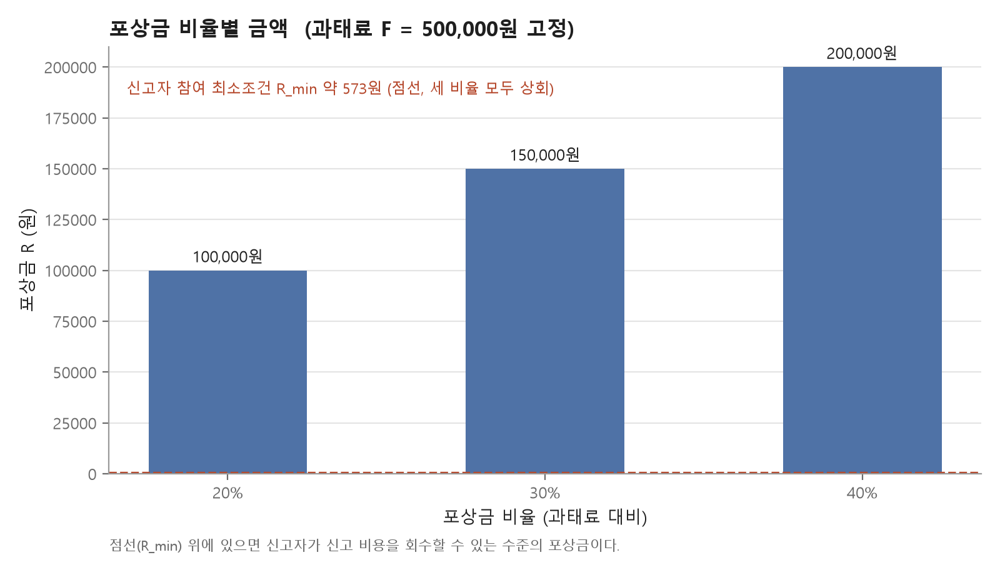

# 점자블록 침범 과태료·신고포상금 금액 책정 분석

> 기대처벌 모형 + 포상금 산정

## 요약

과태료는 **교통약자법 시행령(대통령령 제34871호, 2024.9.15 시행) 별표3 제2호 기준 50만 원**을 고정값으로 쓴다(법 제33조②항 상한 100만 원 이내). 이 저장소는 과태료 금액 산정 자체는 다루지 않고, 50만 원이 주어졌을 때 **신고포상금을 얼마로 정해야 하는지**만 다룬다. 포상금은 **과태료의 20%(건당 10만 원)에 상한을 두는 것**을 권한다. 금액 근거는 실제 국내 사례와 논문이다. 다만 현재 적발확률 0.5%는 가정값이므로, 실제 데이터로 바꿔야 결론이 단단해진다(6장).

## 1. 분석 목적

- 과태료 50만 원(교통약자법 시행령 기준)이 점자블록 위 킥보드 반납을 억지하기에 충분한지 확인한다.
- 부족한 경우, 신고포상이 적발확률을 얼마나 올려야 억지력이 생기는지 역산한다.
- 신고포상금 액수는 얼마로 정해야 신고자가 참여할 유인이 생기는지 산출한다.

## 2. 금액 책정 기준점 (국내 사례)

| 구분 | 내용 | 활용 |
|---|---|---|
| 법정 상한 | 교통약자법 제33조②항: 제11조②항을 어겨 장애인 보도 이용을 방해하거나 훼손한 자에게 100만 원 이하 과태료 | 과태료 F의 법정 상한 |
| 과태료 고정값 | 교통약자법 시행령(대통령령 제34871호, 2024.9.15 시행) 별표3 제2호가 이 위반행위의 과태료 부과기준을 50만 원으로 정한다. 전국 공통 기준이며, 공항·철도역·터미널 등 여객시설과 도로에 적용된다 | 이 분석에서 쓰는 과태료 F = 50만 원(고정) |
| 수원시 사례 | 2026년 4월 교통약자법 과태료 부과 가이드라인 시행. 위 시행령 기준(최고 50만 원)을 그대로 명문화했다. 연말까지 계도 후 내년 1월부터 부과. 공유 킥보드·자전거는 번호판이 없어 위반자 특정이 어렵다는 이유로 제외 | 단계 구조(1차 계도, 2차부터 과태료) 차용 |
| 서울 견인료 | PM 견인료 4만 원(경차와 동일), 보관료 30분당 700원 | 참고용 (이 분석의 F는 견인료가 아니라 과태료) |
| 대구 견인료 | 2025년 7월 조례 개정으로 8천 원 → 3만 원 상향 | 참고용 |
| 포상금 비율 | 수원 과태료의 20%, 파주 40%·1인 연 최대 100만 원, 김제 30%, 인천 연수구 1인 월 10건 이내 (파주·김제·연수구는 쓰레기 불법투기 등 환경 분야 신고포상금 제도이며, PM 전용 제도는 아니다 — 비율 벤치마크로만 참고) | 포상금 R = 과태료의 20~40%, 건수 상한 |

> 별표3 제2호의 50만 원은 국토교통부 보도자료를 인용한 복수 언론 기사(이투데이, 에이블뉴스 등)로 교차 확인했으나, 시행령 별표 원문은 law.go.kr에서 표 형태(JS 렌더링)로만 제공돼 이번 조사에서 원문 전체를 직접 열람하지는 못했다. 보고서 제출 전 국가법령정보센터에서 별표3 제2호 원문을 한 번 더 확인하는 것을 권한다.

## 3. 분석 방법 및 원리

### 3-1. 기대처벌 모형 (Becker, 1968)

**개념:** 이용자는 "위반해서 얻는 이득"과 "걸렸을 때 내는 돈 × 걸릴 확률"을 비교한다. 이득이 더 크면 위반한다.

$$
\text{위반 조건: } B > p \times F \qquad \Rightarrow \qquad p^{*} = \frac{B}{F}
$$

| 기호 | 뜻 |
|---|---|
| $B$ | 위반 이득 (정상 주차구역까지 우회하지 않아서 아낀 비용) |
| $p$ | 적발확률 (위반 1건이 과태료로 이어질 확률) |
| $F$ | 과태료 |
| $p^{*}$ | 억지에 필요한 **최소 적발확률**. 실제 $p$가 이보다 크면 위반이 손해가 된다 |

### 3-2. 신고포상이 적발확률을 올리는 구조

$$
p = p_0 + (1 - p_0)\,\rho\, q
$$

| 기호 | 뜻 |
|---|---|
| $p_0$ | 신고 없이 기존 단속만으로 적발될 확률 (현재 0.5% 가정) |
| $\rho$ | 위반 1건이 시민에게 신고될 확률 |
| $q$ | 신고가 과태료 부과로 확정되는 비율 (0.6 가정) |

이 식을 거꾸로 풀어 **억지에 필요한 신고확률 $\rho^{*}$** 를 구한다.

### 3-3. 위반 이득 B 산정

- B = 우회 시간의 가치 + 우회하는 동안 더 내는 분당 요금
- 시간가치는 2026년 최저시급, 분당 요금은 150원으로 가정
- 3분 우회 시 약 966원, 10분 우회 시 약 3,220원

## 4. 분석 결과

### 4-1. 손익분기 적발확률과 필요 신고확률 (과태료 50만 원 고정)



과태료를 50만 원으로 고정하면 위반 이득 B가 상대적으로 작아, 우회 1~5분 구간에서는 손익분기 적발확률 p\*가 현재 적발확률 가정(p0=0.5%)보다 낮다. 이 가정이 맞다면 해당 구간은 추가 신고 없이도 이미 억지 조건을 충족한다. 우회 10분처럼 이득이 큰 경우에만 추가 신고확률(ρ\* 약 0.24%)이 필요하다.

| 우회 시간 | 위반 이득 B | 손익분기 p\* | 필요 신고확률 ρ\* |
|---|---|---|---|
| 1분 | 322원 | 0.06% | 0%p (기존 단속으로 충분) |
| 3분 | 966원 | 0.19% | 0%p (기존 단속으로 충분) |
| 5분 | 1,610원 | 0.32% | 0%p (기존 단속으로 충분) |
| 10분 | 3,220원 | 0.64% | 0.24%p |

전체 결과는 `results/breakeven_table.csv`에 있다.

### 4-2. 포상금 비율별 금액



신고자 참여 최소조건은 약 573원(신고 1건 소요시간 2분의 시간가치를 확정률 0.6으로 나눈 값)이다. 과태료 50만 원 기준으로는 포상금 비율 20%(10만 원)만으로도 이 조건을 크게 상회한다.

| 포상금 비율 | 포상금 금액 | 참여조건 충족 여부 |
|---|---|---|
| 20% | 10만 원 | 충족 |
| 30% | 15만 원 | 충족 |
| 40% | 20만 원 | 충족 |

전체 결과는 `results/reward_table.csv`에 있다.

## 5. 결과 해석

1. **현재는 이용자에게 실질적 비용이 거의 없는 구조로 보인다.** 견인료는 업체가 낸다. 업계도 불법 주정차를 해도 이용자는 손해 볼 게 없다고 말한다. 따라서 출발점은 금액보다 **부과 대상**이다. 업체의 반납 기록(GPS·반납 사진)으로 이용자를 특정하면 수원시가 공유 킥보드를 제외한 사유가 해소된다. 이 점이 정책 제안의 핵심 논리다.
2. **과태료가 50만 원으로 고정되면, 가정상 적발확률(p0=0.5%)만으로 이미 대부분의 우회 시나리오(1~5분)에서 억지 조건이 충족된다.** 다만 p0=0.5%는 검증되지 않은 가정값이라는 점에 유의해야 한다(6장). 신고자의 최소 참여조건은 약 570원으로, 포상금 비율 20%(10만 원)만으로도 충분히 넘는다. 즉 포상금의 크기보다 신고 경로를 쉽게 만드는 쪽이 더 중요하다. 실증 근거도 같은 방향이다.
   - 중앙행정기관 104개 신고포상금제 분석: 지급 기준의 까다로움과 홍보는 성과에 유의, 포상금액은 유의하지 않음
   - 환경부 쓰레기투기 포상금 도입 후 신고가 1월 434건 → 3월 1,335건으로 증가, 건당 평균 4만 1천 원 지급
3. **포상금을 키우면 부작용이 생긴다.** 서울에서는 견인업체가 직접 신고하고 직접 견인한 사례가 있었다. 2003년 교통위반 신고포상제 폐지 후 전문신고꾼이 쓰레기 신고로 옮겨갔다. 따라서 비율은 20%로 하고 **월 건수 상한, 연간 금액 상한, 견인업체·PM 업체 관계자 지급 제외**를 함께 둔다.

## 6. 실제 데이터 대체 필요 값

현재 적발확률 $p_0$ = 점자블록 위 위반 건수 대비 과태료 부과 건수. 다음 자료로 추정할 수 있다.

- 서울시 견인 실적: 2021년 3만 205건 → 지난해 누적 28만으로 증가
- 서울 열린데이터광장 「서울특별시 전동킥보드 견인 현황」 중 점자블록 구역 건수
- 공유 PM 반납 건수 (업체 자료 또는 정보공개청구)

### 6-1. 저장소 원자료와의 연계

이 저장소의 원자료(`data/raw/`, 분석 1과 공용)에 점자블록 유형 견인 건수가 들어 있다. $p_0$ 추정 시 **분자(적발·견인 건수)** 로 쓸 수 있다.

| 연도 | 유형 표기 (원자료 그대로) | 견인 건수 | 파일 |
|---|---|---|---|
| 2024.1~5 | 점자블록, 엘리베이터 입구 | 956 | `tow_2024_H1.xlsx` (이전 유형 체계) |
| 2024.5~12 | 점자블록 또는 교통약자 엘리베이터 | 2,047 | `tow_2024_H1.xlsx`, `tow_2024_H2.xlsx` (2024년 5월부터 바뀐 유형 체계) |
| 2025 | 점자블록 또는 교통약자 엘리베이터 | 1,420 | `tow_2025_H1.xlsx`, `tow_2025_H2.xlsx` |

- 2025년 구별 상위: 관악구 198, 동작구 192, 송파구 131, 강서구 118, 마포구 108건
- 견인 건수이지 과태료 부과 건수가 아니다. 또 엘리베이터 입구 위반이 같은 유형에 묶여 있다.
- **분모(전체 위반 건수)** 는 원자료에 없으므로 PM 업체 반납 데이터가 필요하다.
- 값이 확보되면 모형 코드의 `PARAMS`만 고쳐 표와 그래프를 다시 뽑는다.

## 7. 참고 문헌 및 출처

### 7-1. 법령

- 교통약자의 이동편의 증진법 제33조②항. [유권해석 정리](https://www.nepla.ai/wiki/교통과-운송/기타/-유권해석-교통약자의-이동편의-증진법-제33조-과태료-jxm9lr7kg9pg)
- 교통약자의 이동편의 증진법 시행령 별표3 제2호, 대통령령 제34871호(2024.9.15. 시행). [국가법령정보센터](https://www.law.go.kr/LSW/lsInfoP.do?urlMode=lsInfoP&lsId=010161)

### 7-2. 학술 논문

1. 신고포상금제도의 특성이 정책성과에 미치는 영향. 『한국정책학회보』 29(1), 2020. [KCI](https://www.kci.go.kr/kciportal/ci/sereArticleSearch/ciSereArtiView.kci?sereArticleSearchBean.artiId=ART002576344)
2. 김도윤·나태준. 신고포상금제도를 통한 쓰레기 불법투기 위험 극복 효과의 분석. 『한국위기관리논집』 11(5), 2015. [KCI](https://journal.kci.go.kr/cemtp/archive/articlePdf?artiId=ART001997305)
3. 성시경·이현국. 과태료 결정요인에 관한 탐색적 연구: 서울시 자치구 주정차위반 과태료. 『사회과학연구』 26(1), 2015. [DBpia](https://www.dbpia.co.kr/journal/articleDetail?nodeId=NODE06094022)
4. 서영현 외. 과태료 부과의 과속운전자 교통법규 위반 억제 효과분석. 대한교통학회 학술발표회, 2017. [DBpia](https://www.dbpia.co.kr/journal/articleDetail?nodeId=NODE07626403)
5. 송정은 외. 킥보드 불법 주차 문제 해결을 위한 도착지 중심 스테이션 증설 알고리즘. 『한국컴퓨터정보학회논문지』 28(2), 2023. [KCI](https://www.kci.go.kr/kciportal/ci/sereArticleSearch/ciSereArtiView.kci?sereArticleSearchBean.artiId=ART002934516)
6. 이윤희·김수재·추상호. 공유 전동킥보드 불법 주차에 미치는 영향 요인 분석. 한국ITS학회 학술대회, 2022.
7. Becker, G. (1968). Crime and Punishment: An Economic Approach. *Journal of Political Economy*, 76(2).

### 7-3. 정부·지자체 자료

- 수원시. 교통약자법 과태료 부과 가이드라인. [수원시청](https://www.suwon.go.kr/sw-www/deptHome/dep_traffic/traffic01/traffic01_11.jsp)
- 수원시. 쓰레기 무단투기 근절. [수원시청](https://www.suwon.go.kr/sw-www/deptHome/dep_env/env_03/env_03_05.jsp)
- 인천광역시 연수구. 환경오염행위 등 신고포상금 지급 기준. [연수구청](https://www.yeonsu.go.kr/main/part/clean/fine.asp)
- 환경부. 쓰레기 무단투기 등 신고자 포상금제 실시방안(2000). [KDI 경제정보센터 소장본](https://eiec.kdi.re.kr/epic_txt/2000/R0005083.HWP)

### 7-4. 언론 기사

- YTN. "[전국][경기] 수원시, 점자블록 침범하면 최고 50만 원 과태료." [기사](https://www.ytn.co.kr/_ln/0134_202607131221416701)
- 이투데이. "여객시설ㆍ도로 장애인주차구역 방해, 도로 점자 훼손 시 과태료." [기사](https://www.etoday.co.kr/news/view/2400413)
- 에이블뉴스. "시각장애인 점자블록 이용 방해·훼손시 '과태료 50만원'." [기사](https://www.ablenews.co.kr/news/articleView.html?idxno=214994)
- 서울신문. PM 견인료 관련 보도. [기사](https://m.go.seoul.co.kr/news/2023/11/03/20231103500048)
- 헤럴드경제. "하루 360대 견인 전동킥보드, 과태료 한 푼 안낸다." [기사](https://mbiz.heraldcorp.com/article/10586607)
- 매일신문. 대구 견인료 관련 보도. [기사](https://www.imaeil.com/page/view/2026042714031777920)
- 이코노미스트. 셀프견인 관련 보도. [기사](https://economist.co.kr/article/view/ecn202502040065)
- 파이낸셜뉴스. 업계 반응 관련 보도. [기사](https://www.fnnews.com/news/202110221635106862)
- 뉴스서울. 파주시 포상금 관련 보도. [기사](https://newsseoul.co.kr/news/view/1065572412311081)
- 전북일보. 김제시 포상금 관련 보도. [기사](https://www.jjan.kr/article/20210426731146)
- 서울시 미디어허브. 2004년 포상금 관련 보도. [기사](https://mediahub.seoul.go.kr/archives/142534)

---

## 8. 재현 방법

```bash
# 저장소 최상위에서
pip install -r requirements.txt
python 03_penalty_model/src/deterrence_model.py
```

- 입력: 없음 (모든 값은 코드 상단 `PARAMS`, `FINE`의 가정값). 원자료 `data/raw/`는 사용하지 않는다.
- 결과: `03_penalty_model/results/breakeven_table.csv`, `reward_table.csv`, `results/figures/fig1_breakeven.png`, `fig2_reward.png`
- `breakeven_table.csv` 컬럼: `detour_min`(우회 분), `B`(위반 이득, 원), `fine`(과태료, 원, 고정값), `p_star_pct`(손익분기 적발확률 %), `rho_star_pct`(필요 신고확률 %), `report_mult_vs_p0`(p\*가 현재 p0의 몇 배인지)
- `reward_table.csv` 컬럼: `reward_ratio_pct`(포상금 비율 %), `reward_amount`(포상금 금액, 원), `r_min`(신고자 참여 최소조건, 원), `meets_participation`(참여조건 충족 여부), `margin`(포상금과 참여조건의 차이, 원)
